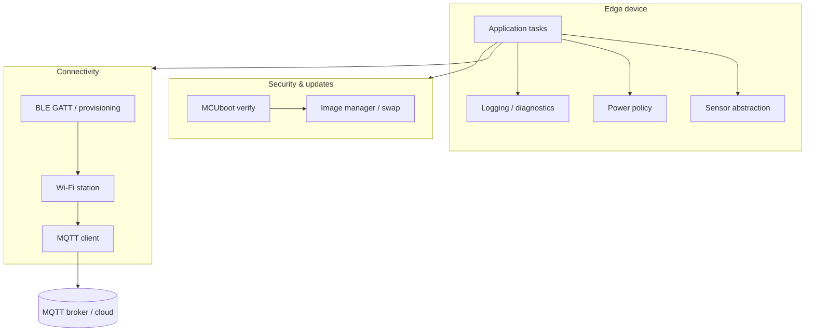
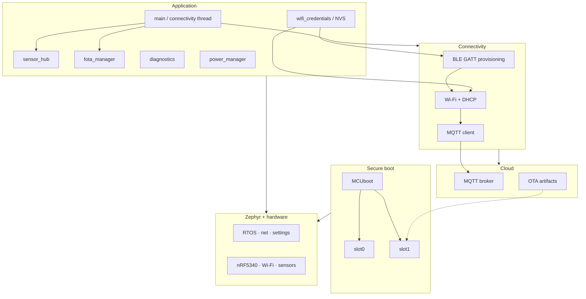
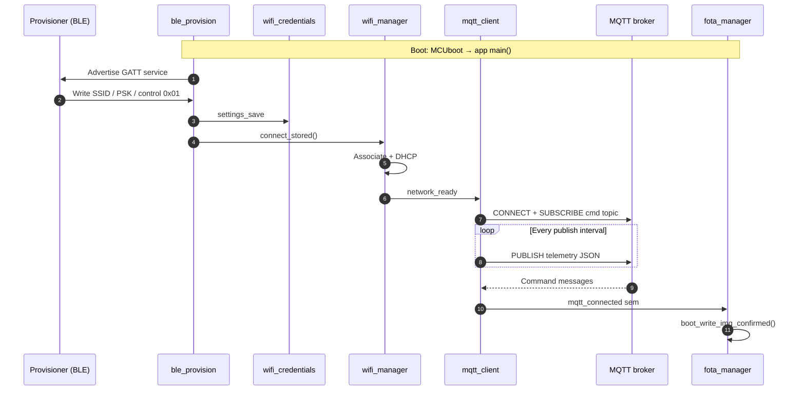

# Secure IoT Edge

Portfolio-grade embedded firmware for a **secure IoT edge device** on **Zephyr RTOS**: dual-radio connectivity, MQTT telemetry, **MCUboot** secure boot, signed **FOTA**, sensors, power management, and structured diagnostics.

## Target hardware (reference)

| Board | Role |
|-------|------|
| [nRF7002 DK](https://www.nordicsemi.com/Products/Development-hardware/nRF7002-DK) (nRF5340 + Wi-Fi 6) | Primary reference: BLE provisioning + Wi-Fi backhaul |
| Any Zephyr board with `mcuboot` + flash partition support | Alternate bring-up |

Adjust `board` in `west build` and overlays under `boards/` for your kit.

## System architecture

High-level layers from hardware through cloud integration:

<p align="center">
  
</p>

Logical view of how edge subsystems connect to connectivity, security, and cloud:



<details>
<summary>Expanded Mermaid (modules & layers)</summary>



</details>

## How it works

End-to-end behavior from cold boot through steady-state operation:

<p align="center">
  
</p>

<p align="center">
  
</p>

<details>
<summary>Sequence diagram (provisioning → cloud)</summary>



</details>

## Features

| Area | Implementation |
|------|----------------|
| RTOS | Zephyr threads, work queues, `k_timer` |
| BLE | Peripheral GAP/GATT for Wi-Fi credential delivery (see `src/ble/`) |
| Wi-Fi | Station mode, reconnect policy (`src/wifi/`) |
| MQTT | TLS-capable client, telemetry + command topics (`src/mqtt/`) |
| Secure boot | MCUboot in secondary slot layout (`bootloader/` + `sysbuild.conf`) |
| FOTA | MCUboot image confirm after MQTT check-in (`src/fota/`) |
| Sensors | BME680 via devicetree or synthetic JSON fallback (`src/sensors/`) |
| Power | Idle backoff when cloud disconnected (`src/power/`) |
| Diagnostics | Heartbeat logging + optional shell (`src/diag/`) |

Runtime flow: **BLE GATT → NVS credentials → Wi-Fi/DHCP → MQTT telemetry + commands → confirm OTA image**. Details: [docs/ble-provisioning.md](docs/ble-provisioning.md).

## Repository layout

```
SecureIOTEdge/
├── west.yml                 # West manifest (Zephyr + MCUboot)
├── apps/secure_iot_edge/    # Main Zephyr application
├── boards/                  # Board overlays & devicetree fragments
├── bootloader/              # MCUboot child image notes & Kconfig fragments
├── docs/                    # Deep dives (FOTA, threat model, bring-up)
└── scripts/                 # Build, sign, and flash helpers
```

## Prerequisites

- [West](https://docs.zephyrproject.org/latest/develop/west/index.html)
- Zephyr SDK (see Zephyr doc for your OS)
- Python 3.10+
- For signing: `imgtool` (from MCUboot, installed via pip or Zephyr env)

## Quick start

```bash
cd SecureIOTEdge
west init -l .
west update

# Build application + MCUboot (sysbuild)
west build -b nrf7002dk_nrf5340_cpuapp apps/secure_iot_edge --sysbuild
west flash
```

Copy `apps/secure_iot_edge/prj.conf.sample` to `prj.conf` and set Wi-Fi/MQTT credentials via Kconfig or `prj.conf` (never commit secrets).

## Configuration

- **`prj.conf`**: enable subsystems (`CONFIG_SECURE_IOT_EDGE_*`).
- **`boards/*.overlay`**: pins, partitions, sensor nodes.
- **`sysbuild.conf`**: MCUboot as bootloader child image.

See [docs/bring-up.md](docs/bring-up.md) and [docs/fota.md](docs/fota.md).

## Security notes (portfolio talking points)

- Verified boot chain: ROM → MCUboot (signature check) → signed application slot.
- Update images signed offline; public key embedded in MCUboot.
- TLS to MQTT broker; optional certificate pinning via `CONFIG_MBEDTLS_*`.
- Minimal attack surface: BLE provisioning window, credential storage in settings/NVS.

## License

Apache-2.0 — suitable for public portfolio repos; replace third-party stack licenses per Zephyr/Nordic terms when shipping binaries.
